<div align="center">



<br/>


[](https://www.linkedin.com/in/somashekar-p-j-77b192294/)
[](mailto:soma2626shekar@gmail.com)
[](http://deadlydotcom.wordpress.com)
[](https://github.com/SomashekarPJ/Portfolio)

</div>

<br/>


```text
 ============================================================
   SYSTEM PROPERTIES                                  [ OK ]
 ============================================================
   Name ......... Somashekar P J  (goes by "Deadly")
   Role ......... AI/ML Engineering Student
   College ...... Ghousia College of Engineering, Ramanagar
   Class of ..... 2027
   Location ..... India
   Focus ........ ML | LLMs | NLP | AI Agents | Full-Stack
                  System Design | Cybersecurity
   Motto ........ Learn > Build > Break > Understand > Ship
 ============================================================
```

> **I don't want to build software that only executes.**
> **I want to build software that helps people think, act and solve.**

<br/>


<div align="center">
<table>
<tr>
<td><a href="https://github.com/SomashekarPJ/AEGIS"></a></td>
<td><a href="https://github.com/SomashekarPJ/CRIME-IQ-"></a></td>
</tr>
<tr>
<td><a href="https://github.com/SomashekarPJ/SafeCircle"></a></td>
<td><a href="https://github.com/SomashekarPJ/CYNAPSE-AI"></a></td>
</tr>
<tr>
<td><a href="https://github.com/SomashekarPJ/Election-Assistant"></a></td>
<td><a href="https://github.com/SomashekarPJ/scamshield"></a></td>
</tr>
</table>
</div>

<sub>Click any window to open its repository. Crime IQ also has a [frontend repo](https://github.com/SomashekarPJ/Crime-IQ-frontend-).</sub>

<br/>


| Folder | Item | Contents |
| :--- | :--- | :--- |
| `\AI` | [FactoryMargin AI](https://github.com/SomashekarPJ/factorymargin-AI) | Agentic procurement and profitability intelligence for small manufacturers |
| `\AI` | [Decision OS v2](https://github.com/SomashekarPJ/Decision-OSv2) | Structured decision-support engine |
| `\AI` | [3LC Hackathon](https://github.com/SomashekarPJ/hackathon-3lC) | Data-centric AI / ML experimentation |
| `\AI` | [Election Assistant](https://github.com/SomashekarPJ/Election-Assistant) | Local-first election guidance |
| `\SECURITY` | [AegisHub](https://github.com/SomashekarPJ/AiegsHub) | Cyclone detection and prevention intelligence hub |
| `\SECURITY` | [Firewall Config & Traffic Filtering Lab](https://github.com/SomashekarPJ/Firewall-Config-Traffic-Filtering-Lab) | Network traffic filtering and firewall configuration |
| `\SECURITY` | [ScamShield](https://github.com/SomashekarPJ/scamshield) | Digital scam protection |
| `\SOFTWARE` | [Freelance Platform](https://github.com/SomashekarPJ/Freelance-platform) | Full-stack freelance marketplace workflow |
| `\SOFTWARE` | [Portfolio](https://github.com/SomashekarPJ/Portfolio) | Personal portfolio engineering |
| `\SOFTWARE` | [Book REST API](https://github.com/SomashekarPJ/book-rest-api-) | REST / backend development |
| `\SOFTWARE` | [Responsive Design Studio](https://github.com/SomashekarPJ/responsive-design---css-media-queries-studio) | Responsive frontend engineering |
| `\SOFTWARE` | [Landing Page](https://github.com/SomashekarPJ/landing-page) | UI / CSS practice |
| `\SOFTWARE` | [Apathy OS](https://github.com/SomashekarPJ/Apathy-os) | Experimental interface work |

<br/>


```text
C:\> run thinking.bat

  PROBLEM > CONTEXT > EVIDENCE > REASONING > OPTIONS
          > DECISION > ACTION > OUTCOME > LEARNING > (repeat)
```

<div align="center">

  
  
  


</div>

<br/>


<div align="center">

[](https://github.com/SomashekarPJ)
[](https://github.com/SomashekarPJ)

[](https://github.com/SomashekarPJ)

[](https://github.com/SomashekarPJ)

</div>

<br/>


```text
 +----------------------------------------------------------+
 |  Connecting to SomashekarPJ ...........  [ CONNECTED ]   |
 |                                                          |
 |  Open to:  collaborations | internships | hackathons     |
 |            AI / ML | security | product engineering      |
 +----------------------------------------------------------+
```

<div align="center">

[](https://www.linkedin.com/in/somashekar-p-j-77b192294/)
[](mailto:soma2626shekar@gmail.com)


</div>
