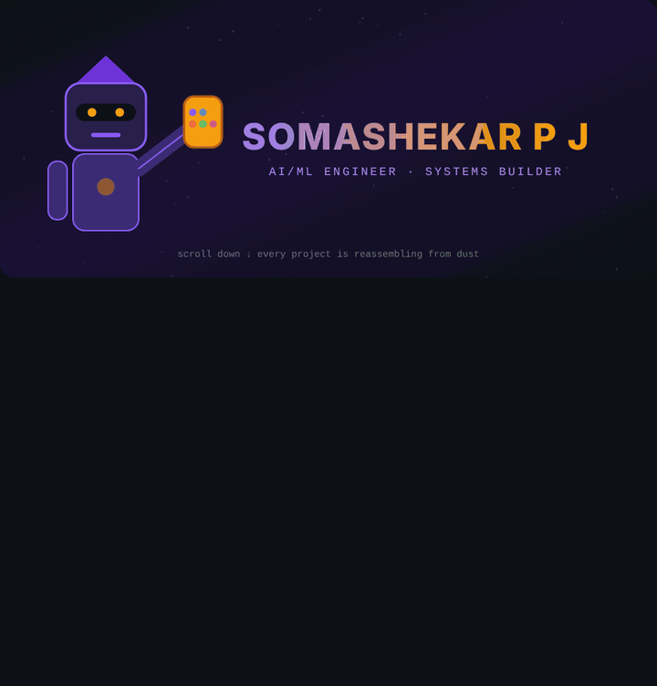

<div align="center">


[](https://github.com/SomashekarPJ)


[](https://www.linkedin.com/in/somashekar-p-j-77b192294/)
[](mailto:soma2626shekar@gmail.com)
[](http://deadlydotcom.wordpress.com)

</div>


## 🧑‍🚀 ABOUT ME

**AI/ML Engineering Student · Problem Solver · Systems Builder · Product Thinker**

📍 India  🎓 Ghousia College of Engineering · Class of 2027

> **I don't want to build software that only executes.**
> **I want to build software that helps people think, act and solve.**

```text
Learn → Build → Break → Understand → Rebuild → Ship → Repeat
```

🔭 **Current focus:** `Machine Learning` `LLMs` `NLP` `AI Agents` `Full-Stack` `System Design` `Cybersecurity`

---

## 🫰 THE SNAP: FLAGSHIP SYSTEMS

> Half of all side projects never ship. Mine reassemble from dust. Click any card to open the repo.

<div align="center">
<table>
<tr>
<td><a href="https://github.com/SomashekarPJ/AEGIS"></a></td>
<td><a href="https://github.com/SomashekarPJ/CRIME-IQ-"></a></td>
</tr>
<tr>
<td><a href="https://github.com/SomashekarPJ/SafeCircle"></a></td>
<td><a href="https://github.com/SomashekarPJ/CYNAPSE-AI"></a></td>
</tr>
<tr>
<td><a href="https://github.com/SomashekarPJ/Election-Assistant"></a></td>
<td><a href="https://github.com/SomashekarPJ/scamshield"></a></td>
</tr>
</table>
</div>

<sub>Crime IQ is split into [backend](https://github.com/SomashekarPJ/CRIME-IQ-) and [frontend](https://github.com/SomashekarPJ/Crime-IQ-frontend-).</sub>

---

## 🧪 PROJECT LAB

<details open>
<summary><b>🛡️ Security Lab</b></summary>

| Project | What it explores |
| --- | --- |
| [**Firewall Config & Traffic Filtering Lab**](https://github.com/SomashekarPJ/Firewall-Config-Traffic-Filtering-Lab) | Network traffic filtering and firewall configuration |
| [**ScamShield**](https://github.com/SomashekarPJ/scamshield) | Digital scam protection |

</details>

<details open>
<summary><b>🧠 AI / Hackathon Lab</b></summary>

| Project | What it explores |
| --- | --- |
| [**3LC Hackathon**](https://github.com/SomashekarPJ/hackathon-3lC) | Data-centric AI / ML experimentation |
| [**Election Assistant**](https://github.com/SomashekarPJ/Election-Assistant) | Local-first election guidance |

</details>

<details open>
<summary><b>💻 Software Engineering Lab</b></summary>

| Project | What it explores |
| --- | --- |
| [**Portfolio**](https://github.com/SomashekarPJ/Portfolio) | Personal portfolio engineering |
| [**Book REST API**](https://github.com/SomashekarPJ/book-rest-api-) | REST / backend development |
| [**Responsive Design Studio**](https://github.com/SomashekarPJ/responsive-design---css-media-queries-studio) | Responsive frontend engineering |
| [**Landing Page**](https://github.com/SomashekarPJ/landing-page) | UI / CSS practice |
| [**Apathy OS**](https://github.com/SomashekarPJ/Apathy-os) | Experimental interface work |

</details>

---

## 🧭 HOW I THINK

```text
PROBLEM → CONTEXT → EVIDENCE → REASONING → OPTIONS → DECISION → ACTION → OUTCOME → LEARNING ↺
```

**THINK → MODEL → BUILD → BREAK → DEBUG → ITERATE → SHIP → REPEAT**

---

## ⚙️ TECH ARSENAL

<div align="center">

  
  
  


</div>

---

## 📊 GITHUB COMMAND CENTER

<div align="center">

[](https://github.com/SomashekarPJ)
[](https://github.com/SomashekarPJ)

[](https://github.com/SomashekarPJ)

### 🐍 Contribution Activity


</div>

---

## 🌌 THE BIGGER MISSION

`🤖 AI AGENTS` · `🧠 INTELLIGENCE SYSTEMS` · `🛡️ SECURITY` · `⚙️ SOFTWARE ENGINEERING` · `🚀 PRODUCT THINKING`

> **What happens when software doesn't just execute instructions, but becomes part of how people and organizations solve problems?**

---

<div align="center">

[](https://github.com/SomashekarPJ)


</div>
